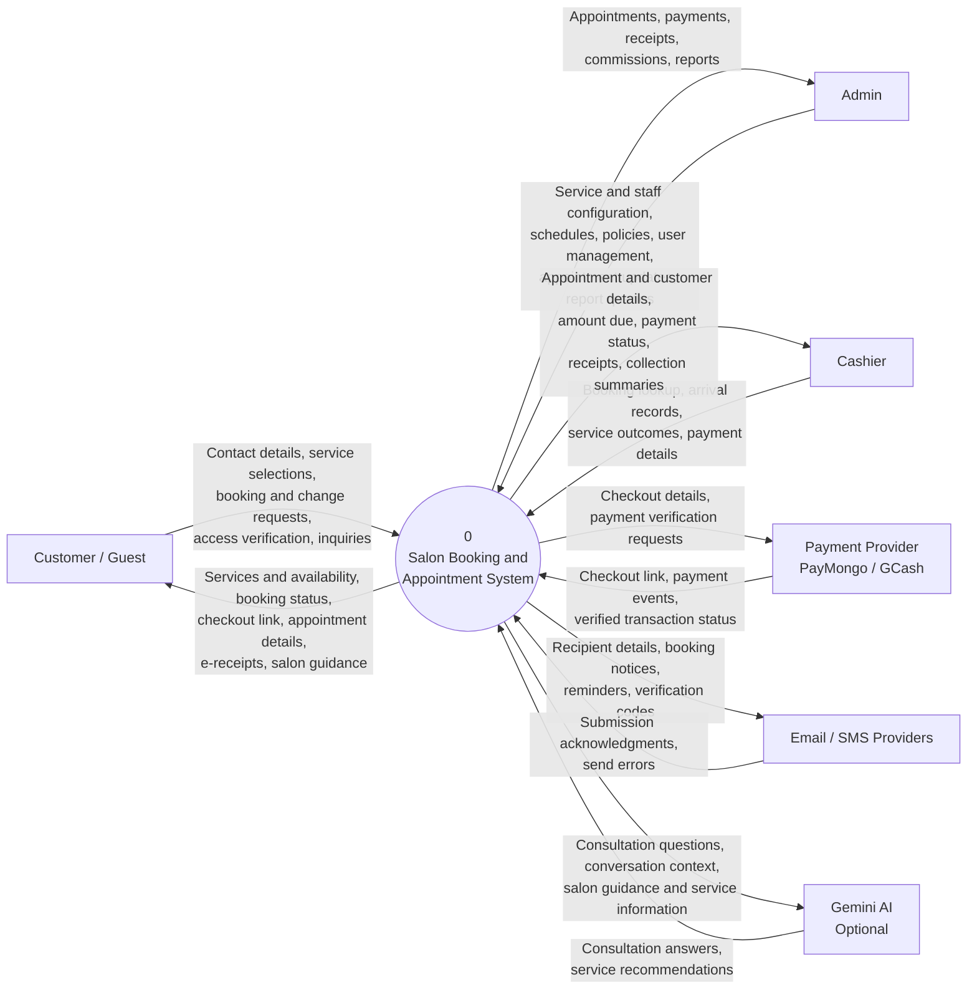

# Level 0 Context Diagram

The Salon Booking and Appointment System is represented as one process (Process 0). Arrows show data crossing its boundary; internal modules and database tables are omitted.

## Scope notes

- Customer / Guest, Admin, and Cashier are the three human actors defined by the system rules.
- Staff/stylists are managed operational records, not direct system users in the current MVP.
- External providers are shown as supporting systems. Provider availability depends on configuration; Gemini is optional.
- Email/SMS providers handle outbound messages. Their acceptance does not guarantee delivery to the customer.
- Gemini provides guidance; the salon system remains authoritative for booking, scheduling, and payments.
- Facebook Messenger is excluded because its setup document describes a future implementation plan.

## Sources

- [System rules](SYSTEM_RULES.md): actors, permitted operations, payment boundary, notifications, and chatbot scope.
- [Architecture](ARCHITECTURE.md): system and provider boundaries.
- [Project README](../README.md): PayMongo, notifications, appointment verification, and reporting integrations.
- [Gemini setup](GEMINI_CHATBOT_SETUP.md): optional consultation integration.
- [Messenger implementation plan](FACEBOOK_MESSENGER_SETUP.md): planned integration status.
